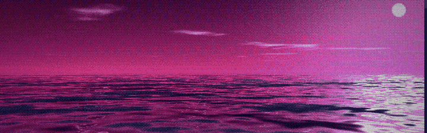

# Carlos Monti



Senior Software Engineer in Buenos Aires. ~19 years shipping web products (Disney, Deloitte, Blockchain.com, Brubank, Despegar).

**Site:** [carlosmonti.com](https://carlosmonti.com) · **LinkedIn:** [carlosmonti](https://www.linkedin.com/in/carlosmonti/)

```sh
npx xmontc
```

My resume as an interactive terminal app ([source](https://github.com/testacode/xmontc)).

The hero on my site is two procedural WebGL2 shader scenes picked at random per load — an ocean horizon with my name sitting on the horizon line, and a top-down shore where the name is the coastline and the waves break on the letters. The `π` button opens a panel with presets and every shader parameter, persisted per visitor. Sea ambience is a CC0 recording cut into seamless loops with ffmpeg.

## Projects

- [Header Editor Pro – Free](https://github.com/testacode/header-editor-pro-free) — Chrome/Firefox extension to modify HTTP headers. Free, no tracking.
- [Weird Science](https://github.com/testacode/weird-science) — interactive 3D science labs for primary and secondary school (Argentina's NAP curriculum).
- [mac-vs-linux-bench](https://github.com/testacode/mac-vs-linux-bench) — why git, pnpm and parallel agents are slower on macOS than on Linux on the same hardware.
- More at [carlosmonti.com](https://carlosmonti.com#projects).
